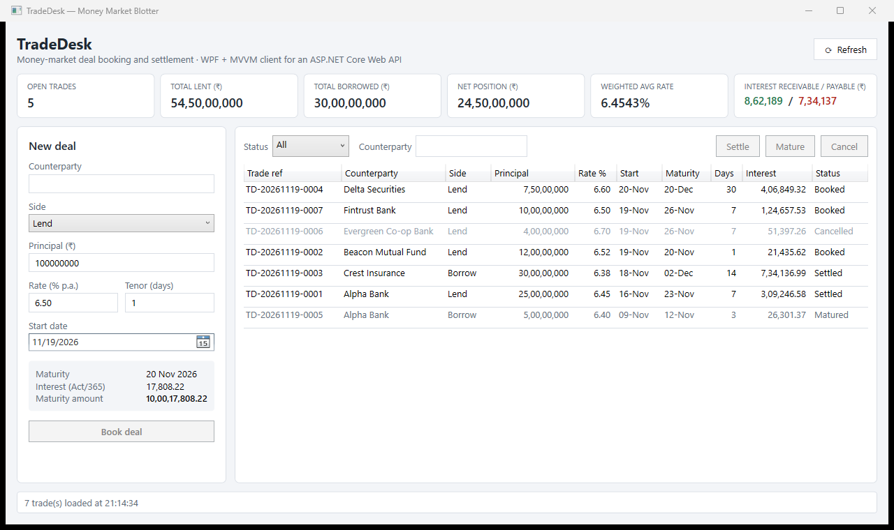
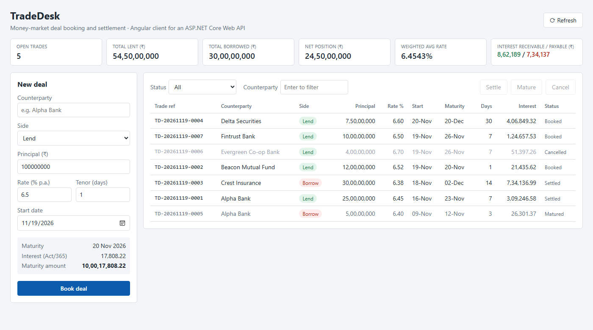

# TradeDesk — Money-Market Deal Blotter

A small but complete **.NET full-stack** sample: an **ASP.NET Core Web API** with EF Core, a **WPF desktop client built with MVVM**, and an **Angular web client**, all working against the same API.

Dealers book short-term money-market deals (repo-style lend/borrow trades), see live interest calculations, and move each deal through its lifecycle: **Booked → Settled → Matured** (or **Cancelled**). The blotter shows the open book, net position, weighted average rate and interest receivable/payable.

> Demo project with made-up counterparties and data. Built to show how I structure .NET desktop and web applications.

| WPF desktop client (MVVM) | Angular web client |
|---|---|
|  |  |

## What it shows

**Backend: ASP.NET Core 9 Web API**
- REST endpoints for the blotter, booking, lifecycle actions and a position summary
- Business rules in a service layer, not in controllers: validation (principal, rate, dates, max tenor) and allowed state transitions
- Domain errors mapped to **RFC 7807 problem details** (400 validation, 404 not found, 409 invalid transition) by one `IExceptionHandler`
- **EF Core** with SQLite by default (runs anywhere, no setup) and **SQL Server** with a single config switch
- `TimeProvider` injected, so date-dependent rules are fully testable

**Desktop: WPF on .NET 9**
- Clean **MVVM**: no code-behind logic; hand-written `ObservableObject` and `AsyncRelayCommand` (no MVVM library) to show how the plumbing works
- Commands enable/disable based on the selected trade's state and disable themselves while a request is in flight (no double-booking)
- Live interest and maturity preview as you type, using the same calculator as the server
- Typed `HttpClient` wrapper that turns API problem details into readable status-bar messages

**Web: Angular 19**
- Standalone components, **signals** and `computed` state, reactive forms with validation
- Typed service layer with central error handling
- Indian number formatting (1,00,00,000) for amounts

**Quality**
- **23 automated tests** (xUnit): calculator maths, service rules against a real in-memory SQLite database, and API integration tests with `WebApplicationFactory`
- **GitHub Actions CI**: builds and tests the .NET solution on Windows and builds the Angular app

## Architecture

```
TradeDesk.sln
├── src/
│   ├── TradeDesk.Core       Domain model, interest calculator, EF Core DbContext, TradeService
│   ├── TradeDesk.Api        ASP.NET Core Web API (controllers, problem-details error handling)
│   └── TradeDesk.Desktop    WPF client (Views, ViewModels, Mvvm, Services)
├── tests/
│   └── TradeDesk.Tests      Unit, service and API integration tests
└── web/                     Angular client (proxies /api to the Web API)
```

```
  WPF client (MVVM) ──┐
                      ├── HTTP/JSON ──► ASP.NET Core Web API ──► TradeService ──► EF Core ──► SQLite / SQL Server
  Angular client ─────┘
```

## Interest calculation

Simple interest on an **Actual/365** day count, rounded to 2 decimals:

```
interest        = principal × rate% / 100 × tenorDays / 365
maturity amount = principal + interest
```

Example: ₹10,00,00,000 lent at 6.50% for 7 days gives interest of ₹1,24,657.53.

## API

| Method | Route | Description |
|---|---|---|
| GET | `/api/trades?status=&side=&counterparty=` | Blotter, with optional filters |
| GET | `/api/trades/{id}` | One trade |
| GET | `/api/trades/summary` | Open position, weighted average rate, top counterparty exposures |
| POST | `/api/trades` | Book a deal (201 + `Location`, or 400 with field errors) |
| POST | `/api/trades/{id}/settle` | Booked → Settled (not before the start date) |
| POST | `/api/trades/{id}/mature` | Settled → Matured (not before the maturity date) |
| POST | `/api/trades/{id}/cancel` | Booked → Cancelled |

The OpenAPI document is served at `/openapi/v1.json`.

## Run it

Requirements: .NET 9 SDK, Node.js 20+ (for the web client), Windows (for the WPF client).

```bash
# 1. API (creates and seeds tradedesk.db on first run)
dotnet run --project src/TradeDesk.Api --launch-profile http
# -> http://localhost:5152

# 2a. WPF desktop client
dotnet run --project src/TradeDesk.Desktop

# 2b. Angular web client
cd web && npm install && npm start
# -> http://localhost:4200
```

Run the tests:

```bash
dotnet test
```

### Use SQL Server instead of SQLite

In `src/TradeDesk.Api/appsettings.json`:

```json
"Database": { "Provider": "SqlServer" },
"ConnectionStrings": {
  "TradeDesk": "Server=localhost;Database=TradeDesk;Trusted_Connection=True;TrustServerCertificate=True"
}
```

## Author

**Mitesh Kelaskar**: .NET developer (C#, WPF, ASP.NET Core Web API, Angular, SQL).
[LinkedIn](https://www.linkedin.com/in/mitesh-kelaskar-91b096151/)
